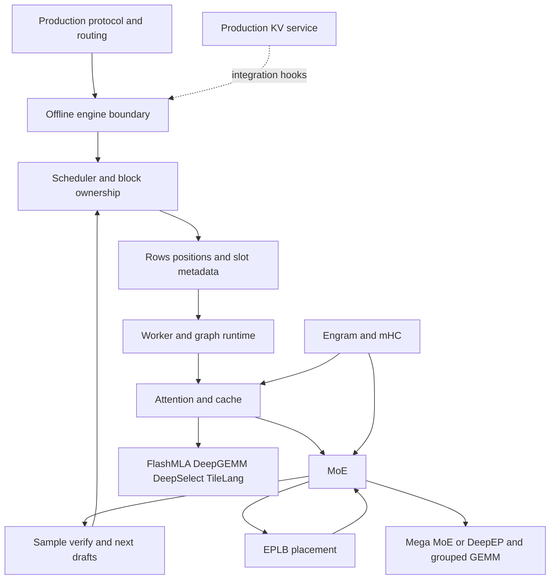

> 当前说明（2026-10-28）：本文是较广的技术研究记录，不再作为页面导航或章节深度要求。当前原理层级与章节职责以 hierarchy/principles.md 为准；算法研究可以保留在文档中，不必全部搬上框架页面。

# DeepInfer 技术分析：从服务系统到执行路径与 kernel

## Provenance / 研究范围

- 官方项目：DeepSeek-AI / DeepInfer，https://github.com/deepseek-ai/DeepInfer 。
- 唯一研究版本：`553741557a57df44a46fb3ab72b6aafeaf945337`，提交时间 2026-10-25 19:59:27 +08:00。以下 GitHub 源码链接全部锁定此版本，不能当作后续 main 的保证。
- 检查时间：2026-10-27，Asia/Shanghai。
- 只读目标：`C:/Users/29043/AppData/Local/Temp/deepinfer-primary-research`，分支 main，浅 checkout。输出仓库与目标仓库是两个根目录。
- 研究问题：DeepInfer 的主要特色如何在系统、引擎、模型子系统、kernel 四个层次连接；每种优化改变了什么成本；公开代码、配置能力和官方生产部署分别支持什么结论。
- 范围：README、部署 Q&A、manifest/config、offline API、C++ scheduler/allocator、worker/metadata/CUDA Graph、V4 attention/index/compression/YOCO、MoE/EPLB、DFlash/DSpark、Engram、结构化输出、确定性相关代码与测试意图。历史演化不在范围。
- 防止把研究缩成一个垂直切片的初始预算：约 90 个相关文本文件、2 MiB；首先清点全部 348 个 tracked entries，再沿调用边阅读命中范围。最终报告包含 115 个固定源码链接、51 个独立源文件（这些文件全文共 783,585 B；实际按相关范围读，不等于逐行审计全文）；另读取 manifest/config、平台和测试的代表范围。核心路径深入，边缘适配与测试只读代表范围。
- 排除：模型权重、二进制图片、运行时缓存、生成物、环境密钥、未跟踪文件、vendor 实现内部、完整模型训练数学。没有下载权重、初始化 submodule、安装依赖、运行 upstream Python、build、test 或 GPU inference。
- 元数据回执：`git rev-parse HEAD` 得到上述 SHA；`git ls-files` 为 348 项；逐组件检查 tracked 路径涉及 399 个位置，未发现可读取 tracked 路径中的 reparse point。输出目录逐级检查没有链接，创建前最终文件不存在。
- 初始目标状态已有六个删除项：`vendor/DeepEP`、`vendor/DeepEP-Ascend`、`vendor/DeepGEMM`、`vendor/DeepGEMM-Ascend`、`vendor/DeepSelect`、`vendor/FlashMLA`。这些 gitlink 的工作树内容不可用，研究保留现状；不能从调用名声称已经读过其 kernel 内部。
- 方法：采用新安装的 [Codebase Knowledge Builder](/C:/Users/29043/Documents/LLM-Infra-Explorer/.agents/skills/codebase-knowledge-builder/SKILL.md) 的 recon、deep-dive、artifact template，并应用本项目新增 [technical-analysis reference](/C:/Users/29043/Documents/LLM-Infra-Explorer/.agents/skills/develop-interactive-module/references/technical-analysis.md) 的广度与教学衔接要求。
- 证据标签：`observed / code` 是直接读到的实现；`observed / doc` 是直接读到的官方陈述，尚非本次运行证明；`inferred` 是从输入输出与操作连接推导的收益或教学建议；`unknown` 是源码/运行证据不足；`not applicable` 是该层不适用。
- 总体可信度：公开控制流、数据所有权与分派条件高；性能方向是结构性推导；实际延迟、带宽、质量变化、生产启用组合均未实测。本文的“实测”指 skill 在这次静态分析任务中的实际使用，不指运行 DeepInfer。

## Executive Summary / 主要结论

**DeepInfer 应解释为一套协同优化的执行框架，不能仅由“请求队列 + KV 块 + CPU/GPU 重叠”代表。** 公开调用链把调度产生的 query rows，映射成 attention 的稀疏/压缩 KV 访问、MoE 的专家路由与低精度计算，再把采样和验证的接受结果回填到 cache 与调度状态。CUDA Graph、融合算子、EPLB、DSpark 和 YOCO 都在这条链上，改变不同成本，而非互斥的框架模式。[LLMEngine.step:860][S03]、[DeepseekModel.forward:154][S08]、[decoder_layer.py:97][S09]、[deepseek.py:383][S10]（`observed / code`）

需要始终分开三层事实：

1. **官方描述的生产服务系统**：Recipe 协议转换，VE/Prefill/Decode 分离，P/D/VE 请求路由，跨请求 KV 存储，扩缩容与容错。[Q&A:23][D01]（`observed / doc`）
2. **公开 offline 引擎**：`LLM.generate`、step scheduler、GPU block/state manager、模型/采样/分布式 runtime；有分离相关类型和 hooks，但 README 明确尚缺完整 KV 服务、E/P/D 集成及 DP 请求负载均衡。[README:38][S01]、[llm_engine.py:800][S05]（`observed / code + doc`）
3. **已实现能力不等于当时线上启用**：README 支持 balanced CP，源码有 mirror CP；官方生产 Q&A 却写当时不用 TP/CP。EPLB 的公开实现也不意味着示例默认启用了周期重排；参数必须逐层追踪。[Q&A:45][D02]、[parallel_state.py:70][S24]、[environ.py:120][S35]、[examples/_config.py:66][S36]（`observed`）

最重要的证据边界：本 checkout 缺少 DeepGEMM / DeepEP / FlashMLA / DeepSelect 的 submodule 内容。因此本文能确认“在哪些条件调用哪个 API、输入布局和下游消费”，能读入库 TileLang kernel，**不能宣称已证明外部融合 kernel 的指令级流水、通信完全隐藏或线上收益**。官方报告的速度数字也不能移植为浏览器 toy 的速度。[.gitmodules:1][S40]（`observed + unknown`）

## Architecture and Boundaries / 四层架构与所有权

| 层次 | 元件及职责 | 接口与状态所有者 | 证据与边界 |
| :--- | :--- | :--- | :--- |
| 生产服务入口 | Recipe 编码/解析，多协议输入，分别分配 VE、P、D 资源 | 请求路由、prefix 匹配在服务层；不是本公开 offline `LLM` 的职责 | [Q&A:31][D01]、[Q&A:290][D12]，`observed / doc`；外部 Recipe 项目未研究 |
| 生产存储与集群控制 | block KV 在 3FS；SWA KV 在 host memory；扩缩容、故障 reroute | 跨请求缓存目录、存储节点、机器配额属于生产系统 | [Q&A:129][D05]、[Q&A:193][D07]，`observed / doc`；完整集成未公开 |
| 单引擎控制面 | offline API、scheduler、allocator、metadata pool、输出池 | `Sequence` 拥有 committed tokens、KV valid length、block table、inflight、MTP 状态；scheduler 拥有队列 | [llm.py:168][S02]、[sequence.hpp:200][S06]、[scheduler.hpp:275][S04]，`observed / code` |
| 设备执行与分布式数据流 | Worker、ModelRunner、InputMetadata、GraphRunner、process groups/userbuffer | tensor rows、位置、slot mapping、有效 mask、跨 batch remap；EP/CP/Engram group 分开 | [worker.py:89][S07]、[model_runner.py:308][S11]、[parallel_state.py:70][S24]，`observed / code` |
| 模型子系统 | attention + SWA/compressed KV/index；MoE；mHC；Engram；DFlash | KV source / index-K source / Top-K source、专家物理映射、draft proposal pool 各有所有者，不能合并成一份共享状态 | [attn.py:752][S12]、[cross_layer.py:23][S17]、[mlp.py:149][S18]、[dflash.py:188][S27]，`observed / code` |
| 算子与 kernel | FlashMLA attention、DeepGEMM matmul/Mega MoE/Mega mHC、DeepEP communication、DeepSelect Top-K、TileKernels、入库 TileLang | API 契约包括 dtype、scale、stride、page/slot、placeholder 与真实 row；kernel 后端按平台选择 | [attention_backend.py:26][S13]、[index_attn.py:421][S15]、[tilelang_ops/ops.py:1][S31]，外部 kernel 内部 `unknown` |

生产架构与公开执行链的关系可表达为：

图中虚线表示生产系统与公开引擎的衔接边界；不表示现有 checkout 已有可用存储服务。mHC 与 Engram 是模型前后处理/数据获取路径，不是 attention 与 MoE 的可替换算法。模型层内先 attention 后 MLP，但跨步 CPU/GPU 执行会重叠。[decoder_layer.py:97][S09]、[worker.py:89][S07]（`observed / code`）。

## Behavior Trace / 以一组 query rows 贯穿执行

### 正常路径（observed / code）

1. **输入与准备**：`LLM.generate` 把输入请求加入引擎，`_run_engine` 调用 step，输出对象跨步保留时必须 clone。输入若有图片或 grammar，会涉及异步准备；准备完成才可调度，不要把全部入口当成立即可执行的 token array。[llm.py:111][S02a]、[so_matcher_builder.py:97][S32]、[multimodal_processor.py:248][S33]
2. **选步型与工作量**：NORMAL 模式先决定本 DP 组本步做 prefill 还是 decode。prefill 由 waiting 队头顺序处理；decode 消费 running。输出 `SchedulerOutputs` 的 `seqlens_q`、`num_batched_tokens` 与 metadata 是实际设备工作量契约，不只是屏幕计数。[scheduler.hpp:275][S04]
3. **资源到物理地址**：C++ scheduler 确保 block/state 可用，构造 block tables；输入准备把逻辑位置、query rows 和 physical slots 对齐。KV valid prefix、已分配块容量、未完成 forward 的 sampled token 和 draft 候选是四种不同状态。[sequence.hpp:200][S06]、[sequence.hpp:291][S06a]、[zos.cpp:144][S34]
4. **设备输入依赖**：ZOS 时 CPU 账本落后一个 decode，`_correct_seqlens_qk` 以 request remap 连接前后 batch；GPU input gather 使用之前的 sampled token IDs / draft IDs，不能拿 stale CPU token 发起下一次 forward。`nextn=0` 时 query length 恒为 1，inflight 已能预测 key length；可变验证时再用 accepted counts 修正。[worker.py:191][S07a]、[cuda/gather_input_ids_zos.py:15][K03]
5. **主模型层循环**：embedding → 可选 CP mirror 排列与 Engram hash/fetch → 每层 attention/mHC/MoE → norm/output。YOCO compact 在 producer/consumer 边界换 metadata 与 hidden row 布局；DFlash target hidden 按契约存下并更新 draft main cache。[deepseek.py:154][S08]、[decoder_layer.py:97][S09]
6. **attention 路径**：Q projection；SWA KV 处理；压缩/存 main KV；index-K projection/cache；DeepGEMM MQA scores → DeepSelect Top-K → 逻辑索引到物理槽。prefill 拼出待 attention 的 KV 视图，decode 直接给 paged cache 与稀疏 indices；FlashMLA API 执行 attention，随后 value/output projection。[attn.py:752][S12]、[index_attn.py:516][S14]、[attention_backend.py:26][S13]
7. **MoE 路径**：gate 选择 logical experts，再经 EPLB 映射为 physical experts。运行时在融合 Mega MoE 与 fallback 之间分派。fallback 才在 Python 编排层显式表现为 DeepEP dispatch → grouped GEMM → SwiGLU/cast → grouped GEMM → combine，并叠加 shared expert。不能在融合路径之后再画一次 fallback。[mlp.py:359][S19]、[mlp.py:565][S20]
8. **验证、draft 与统计反馈**：sampler 验证旧 proposal 的有效连续前缀，首拒绝处 residual resampling 或全部接受后的 bonus token，然后生成下轮 DFlash drafts / confidence。EPLB step 更新专家统计与可能的重排。CPU `process_outputs` 最后提交 accepted output、stop status 和 KV valid count。[sampler.py:59][S26]、[deepseek.py:383][S10]、[scheduler.hpp:872][S04d]
9. **返回与 drain**：prompt/non-ZOS 立即 CPU post-process；ZOS decode 留给下一次 step，在当前 forward 已 launch 后处理之前结果。最后显式 flush。在 EOS 已产生而 CPU 尚未知时可能多发一个 forward，其晚到输出对 finished sequence 被丢弃；这不是多提交一个 token。[worker.py:89][S07]、[llm.py:168][S02]、[scheduler.hpp:872][S04d]

### 错误路径与边界（observed / code）

| 条件 | 实现行为 | 教学影响 | 证据 |
| :--- | :--- | :--- | :--- |
| prompt 超长或永远无法分配 | 标为 ignored；暂时无法分配则等待 | 小 chunk 预算不使超出整个池容量的 prompt 变得可容纳 | [scheduler.hpp:351][S04a]、[block_manager.hpp:119][S05a] |
| slot 已满或 prefill 实际没有排到请求 | 第二轮 DP vote 后回 decode | 避免无穷 empty-prefill；不能简写成“有 waiting 就总优先 prefill” | [scheduler.hpp:275][S04] |
| block 压力 | 根据实际 comparator 抢占长输出序列；可重算时清 cache/inflight/MTP 后保留 committed tokens 回 waiting | source 附近“抢占最短”的注释与代码相反；以代码排序和索引为准 | [scheduler.hpp:559][S04b]、[scheduler.hpp:766][S04c] |
| COMPLETION 无 prefill 通道 | 禁止配置抢占后重算；要求 stop-preempted | 分离类型存在不代表可任意重算 | [scheduler.hpp:100][S04e] |
| structured output 编译或状态失败 | 异步 future/matcher 失败流、终止该 request；SO 抢占不能直接重算 | grammar 状态必须与输出/cache 生命周期一致 | [so_matcher_builder.py:58][S32a]、[llm_engine.py:910][S03a]、[scheduler.hpp:766][S04c] |
| 图片准备失败或 worker hang | 请求失败回传；hang 分支中止引擎进程 | 不是所有 error 都局部重试；未声明生产容错已公开 | [multimodal_processor.py:264][S33a] |
| 不支持的 head/layout/backend | assert / ValueError；kernel dispatcher 缺 factory 报 KernelUnavailableError | backend 存在不代表支持所有组合 | [attention_backend.py:8][S13a]、[cuda/fused_transform.py:17][K01]、[ops.py:25][S31a] |

## Framework Feature Ledger / 主要机制盘点

每项同时写“问题 → 实际变化 → 收益来源 → 代价/退化条件”。收益来源标为 `inferred` 时只表示结构性因果，没有赋予测得的速度值。

### 1. E/P/D 分离、Wide-EP 与服务路由

- **问题**：vision、prefill、decode 的算力/带宽/延迟目标不同；大 EP 下慢 rank 会限制整组步速。
- **变化**：官方生产把 VE、P、D 独立部署；attention 使用 DP，MoE 使用 EP。Q&A 描述较小 P EP 与较大 decode EP，以分别匹配内存与批次形状。
- **收益来源**：独立配额控制 TTFT/TBT；Wide-EP 扩大 MoE 聚合批次、分摊专家权重流量（`observed / doc` + `inferred`）。
- **代价**：P→D 状态传输、更多通信/路由与容错协调；大通信域对慢卡/坏卡更敏感。公开只保留引擎类型/hooks，服务负载均衡与完整分离不在本 release。
- **证据**：[Q&A:23][D01]、[Q&A:45][D02]、[Q&A:193][D07]、[README:38][S01]、[llm_engine.py:800][S05]。
- **不确定边界**：生产实时启用规模、硬件拓扑和分流策略效果 `unknown`；不能从源码重演完整集群。

### 2. Prefill/decode 调度与 chunking

- **问题**：长 prompt 占用 step；token 数、context 长度、sequence slots、KV/state 不能互相替代。
- **变化**：公开 NORMAL 用同型 DP 投票、90%块使用水位和 ALL/ANY 间隔；prefill FIFO 同时约束 token、full-context sum、slot、prompt 长度与资源。partial chunk 仅计算，不产出 token，回到队头；fresh prompt 首次按完整当前长度分配块。
- **收益来源**：控制单 step 工作量与内存承诺，保留 decode 推进机会；ANY 提供组内孤立 prefill 等待上界的尝试点（`observed / code` + `inferred`，不保证必然能分到资源）。
- **代价**：队头阻塞、空陪跑、prefill 等待及 chunk 元数据开销。官方生产文档另描述按拟合二次成本方程消耗时间配额；公开 `scheduler.hpp` 路径没有这套 `compute_quota_limit` 求解，不能混为同一实现。
- **证据**：[scheduler.hpp:275][S04]、[scheduler.hpp:351][S04a]、[environ.py:180][S35a]、[Q&A:105][D04]。
- **状态**：公开实现 `observed / code`；生产配额算法 `observed / doc`；配额算法与当前 public scheduler 的完整对应 `unknown`。

### 3. GPU block/state 生命周期与跨请求 KV 服务

- **问题**：页式长上下文、SWA 固定窗口/压缩 accumulator、fork/refcount、inflight slack 必须各自维护。
- **变化**：`BlockManager` 的 0 号保留、free list/refcount 与独立 state manager；`Sequence.get_num_blocks` 计入 committed length + inflight + draft reservation；`KvCacheState` 区分 optimistic 与实际 commit。main/indexer KV 页和 SWA/state slot 是不同布局。
- **收益来源**：复用有限 GPU 槽位、保留真实有效前缀，避免把 rejected draft 当作已提交状态；共享 cache source 减少重复分配（`observed / code` + `inferred`）。
- **代价**：reserve 大于 valid；finish/release 有同步时机；fork 需要 pin/copy；抢占重算耗费工作。生产 3FS/host cache 系统是另一层，公开 hooks 存在并不实现持久存储。
- **证据**：[block_manager.hpp:27][S05b]、[sequence.hpp:200][S06]、[sequence.hpp:291][S06a]、[cache_engine.py:206][S16]、[llm_engine.py:800][S05]、[Q&A:129][D05]。
- **不确定边界**：真实命中率、3FS 性能和请求保存时机的完整线上实现 `unknown`。

### 4. 异步调度 ZOS：消除 host bookkeeping 气泡

- **问题**：同步采样结果返 CPU 后再做 post-process 和 schedule，会产生设备空档。
- **变化**：先 launch 当前主模型，再等上一轮 sample event、处理上一轮 CPU ledger，再 launch 当前 sampler；当前 decode CPU commit 延迟一轮。GPU remap/input gather 提前消费已在设备上产生的 sampled IDs；可变 MTP 还纠正 q/k。默认是否开启需看 `EngineArgs` 与 `EngineType`，不能只看 EnvVar.bool 的低层 false 缺省。
- **收益来源**：重叠 CPU bookkeeping/下一 batch launch 与已有设备计算（`observed / code` + `inferred`）；不是把数据依赖或 CPU 时间设为零。
- **代价**：前后 batch remap、pinned H2D/D2H、inflight 预留、late finished result 丢弃、drain、pool 延迟回收；性能受 CPU 与 GPU 工作比例限制。
- **证据**：[worker.py:89][S07]、[worker.py:191][S07a]、[cuda/gather_input_ids_zos.py:15][K03]、[arg_utils.py:48][S37]、[engine_type.py:15][S37a]、[Q&A:266][D10]。

### 5. CUDA Graph 与 runtime performance curve

- **问题**：decode 的许多小 kernel 有 host launch 成本；variable verification 必须知道不同 total-q 对硬件时间的影响。
- **变化**：按 power-of-two warmup + 间隔 batch sizes capture，选不小于 total-q 的 graph；固定输入/输出 storage 并 padding。ZOS 可把 metadata/device preparation 纳入图。DFlash 有独立图；profile/cache decode graph 时间供 DSpark 使用。
- **收益来源**：减少逐 kernel host 发射、复用地址；让验证预算使用真实配置的时间曲线（`observed / code` + `inferred`）。
- **代价**：capture/初始化、graph memory/padding、形状上限、缓存性能曲线适用性；eager/Prompt engine 有不同分支。不应把 graph size 和真实请求数当成同一个量。
- **证据**：[model_runner.py:53][S11a]、[cuda_graph_runner.py:41][S25]、[cuda_graph_runner.py:143][S25a]、[model_runner.py:562][S25b]、[worker/base.py:274][S25c]。

### 6. V4 attention：SWA、压缩 KV、稀疏选择是协作关系

- **问题**：长上下文全量访问的成本；压缩后仍需为 query 选择信息，同时保留近邻上下文。
- **变化**：attention 根据配置同时访问 SWA 与 compressed main KV；indexer 为压缩位置评分选 Top-K。prefill 把缓存与当前 SWA、压缩 KV 装配为 dense-addressable 输入视图；decode 直接向 FlashMLA 交 paged buffers 与选中的物理 indices。
- **收益来源**：压缩减少存储行、Top-K 减少主 attention 读取行、SWA 固定近邻窗口；indexer 自己的 matmul/Top-K/加载仍有成本（`observed / code` + `inferred`）。
- **代价**：index scoring、候选元数据、gather/load、cache layout；对短序列或过大的 Top-K，选择开销可能占比上升。不能把 SWA、CSA/HCA/DSA 画成互斥引擎模式，也不能省掉 indexer 成本。
- **证据**：[attn.py:589][S12a]、[attn.py:628][S12b]、[attn.py:752][S12]、[index_attn.py:516][S14]、[attention_backend.py:26][S13]。
- **边界**：具体 checkpoint 每层 ratio / Top-K /共享图由外部配置决定，当前未下载权重；不能由通用类名推断所有 layer 相同。

### 7. Indexer 的两级候选与 source 共享

- **问题**：索引器全量评分本身可能昂贵；每层重复 index-K、Top-K 和加载浪费计算/内存。
- **变化**：`SharedLayerTopology` 分别归一化 main KV source、index-K source、index module/Top-K source；这些 segment 有兼容性约束。可配置 candidate-block source，以 block score 先裁候选，再在候选域算 sparse MQA/Top-K，并还原逻辑索引。
- **收益来源**：重用 source 数据与候选、减少后续 indexer 评分域；不是“所有层共享同一份 Top-K”（`observed / code` + `inferred`）。
- **代价**：来源顺序、segment refinement、候选大小与页对齐约束；候选改变了搜索范围，不能仅称无损 kernel 加速。实际启用层图与质量差异 `unknown`。
- **证据**：[cross_layer.py:23][S17]、[index_attn.py:204][S14a]、[index_attn.py:284][S14b]、[index_attn.py:456][S14c]。

### 8. FlashMLA attention 分派与融合边界

- **问题**：norm/RoPE/attention/RoPE/cast 中间物化和多次 kernel launch；不同精度/layout 需要明确契约。
- **变化**：`V4AttentionBase` 依据 engine 类型、sparse/packed、head 数、平台、batch-invariant 条件选择 fused path，并预排列 Q/Wv 权重。backend 调用 fused prefill/decode 或非融合 FlashMLA sparse API；fallback 可将 head 补到支持数再切回。
- **收益来源**：融合减少中间输出和 launch；page/Top-K metadata 避免 attention 访问全上下文（`observed / code` + `inferred`）。
- **代价**：支持 head 数/维度、预排列权重、输出 FP8 scale 布局和下游 Wv 契约；某些 dense packed decoding、NPU 或配置不走融合。不能把不同 path 固定串起来。
- **证据**：[attn.py:65][S12c]、[attn.py:111][S12d]、[attention_backend.py:8][S13a]、[attention_backend.py:26][S13]。
- **unknown**：外部 FlashMLA tile/warp/SASS 细节。本次只确认调用接口。源码 `is_fp8_kvcache=True` 的注释不能覆盖实际 main FP4/SWA FP8 的格式定义。[cache_common.py:119][K05]

### 9. 低精度不是一个“FP4 开关”

- **问题**：权重/activation/KV/indexer 的通信、容量和吞吐限制不同。
- **变化**：Main FP4 cache 是 512 个 E2M1 值 + 每 16 个一份 E4M3 scale；SWA MXFP8 是 512 个 E4M3 值 + 每 32 个一份 UE8M0 scale；index FP4 是 128 维且 per-32 UE8M0；routed expert FP4 权重、FP8 activation 另有打包布局。gate projection 仍 BF16。
- **收益来源**：减少不同边界的字节、使用支持的低精度 GEMM（`observed / code` + `inferred`）。512 维 Main FP4 的 288 B 与 SWA 528 B 来自格式推导，不是整层/整模型字节数。
- **代价**：scale 空间、量化误差、格式转换、stride/alignment；真实权重 FP4 加载要求符合 checkpoint，不能把任意 FP8 权重直接宣传为可用 FP4 模型。
- **证据**：[cache_common.py:119][K05]、[cache_engine.py:206][S16]、[mlp.py:41][S18a]、[moe.py:40][S18b]、[Q&A:213][D08]。

### 10. 入库 TileLang 融合与状态 kernel

- **问题**：投影后 norm/位置变换/量化/写 cache、压缩跨 chunk tail、ZOS token gather 都是实际 runtime 开销。
- **变化**：融合 kernel 可执行 norm → RoPE → Hadamard → cast → 按 slot mapping store；compression kernel 分别处理 prefill/decode、读取旧 tail 后更新 ring accumulator；ZOS gather 从 remap 取上轮 sampled/draft IDs。
- **收益来源**：少物化、少 launch、把地址与状态处理留在 device（`observed / code` + `inferred`）；不是单纯把 attention 公式逐行搬到 kernel。
- **代价**：专门维度、量化格式组合、shared/fragment/stride 与读写顺序约束；backend 符号存在性与 NPU 限制不同。已读代表 kernel，不宣称覆盖全部 TileLang/TileKernels。
- **证据**：[cuda/fused_transform.py:17][K01]、[compress.py:131][K04a]、[cuda/compress.py:31][K04]、[cuda/gather_input_ids_zos.py:15][K03]、[ops.py:1][S31]。

### 11. MoE 参数、逻辑路由与物理副本

- **问题**：模型 expert 身份与 GPU 上为负载均衡复制的实体不是同一编号空间。
- **变化**：`moe.py` 是容器：logical / extra / physical / local expert 数；`mlp.py` 负责实际执行。gate 选择逻辑 expert，使用 `logical_to_physical_map` 与 replica count 进入物理槽。shared expert 独立于 routed experts；GPU 可用 fused mega gate。profiling 的强制随机/不平衡分支不是正常模型路由。
- **收益来源**：在不改变逻辑 expert 权重身份的前提下利用多个副本；融合 gate 少中间操作（`observed / code` + `inferred`）。
- **代价**：冗余专家占内存，数量要向 EP divisibility 对齐，映射和统计必须同步；不能把用户 token 平均分卡等同于专家均衡。
- **证据**：[moe.py:1][S18c]、[mlp.py:149][S18]、[mlp.py:359][S19]、[eplb/__init__.py:21][S21a]。

### 12. Mega MoE 与显式 DeepEP fallback

- **问题**：MoE dispatch、grouped GEMMs、activation、combine 的通信/launch/中间数据与 shared expert 工作需要协调。
- **变化**：在支持平台/精度且 EP 组位于同一 NVL domain 时选择 Mega MoE，分配 SymmBuffer，预转换权重；前序 norm/cast 可直接写 SymmBuffer 的 FP8/scale。调用单个 `deep_gemm.*mega_moe` API，并可携带 shared weights。否则使用 DeepEP EPBuffer 异步 dispatch/combine 及 grouped GEMM 显式路径，shared forward 与 combine event 协调。
- **收益来源**：更大的融合边界减少中间交接、launch，并支持通信/计算协同（`observed / code` + `inferred`）；外部库内部究竟多少 kernel、怎样隐藏通信 `unknown`。
- **代价**：拓扑/精度/布局条件，userbuffer 内存、预处理与维护；fallback 还需通信 SM 配额与 event 等待。不能把 API 单调用解释成“单一 GPU kernel 无通信”。
- **证据**：[mlp.py:184][S18d]、[mlp.py:274][S18e]、[mlp.py:406][S20a]、[mlp.py:461][S20b]、[mlp.py:528][S20c]、[mlp.py:565][S20]、[userbuffer.py:63][S23]。

### 13. EPLB：统计 → 复制 → 放置 → 权重迁移 → 路由

- **问题**：expert 热度不均，Wide-EP 一步由最慢 rank 限制；简单平均 request 数不能解决专家负载偏斜。
- **变化**：MoE 执行累计 physical expert token counts；按窗口汇总成 logical counts 并 all-reduce；贪心选择增加哪些 logical replica，再按历史 step 的 rank 峰值目标排 physical slots；迁移 expert weights 和 scales，最后更新双向映射。GPU 同 NVL 域可用 symmetric-memory shuffle，否则走其它搬运路径。重排周期可关闭；示例、生产建议与默认 EnvVar 不可混用。
- **收益来源**：把热 expert 的工作分给副本、降低每步最大 rank load（`observed / code` + `inferred`）。
- **代价**：多放权重、统计窗口/通信、同步与 shuffle 时间、热度变化滞后；重排不是免费、也不是所有 batch 都会更快。
- **证据**：[eplb/__init__.py:131][S21]、[eplb/__init__.py:223][S21b]、[policy.py:12][S22a]、[policy.py:73][S22]、[deepseek.py:383][S10]、[Q&A:93][D03]。
- **边界**：EPLB 公开且已读；P/D/VE 请求路由负载均衡是另一个层次，不能因为 README 说 load balancing 未齐备而说 EPLB 未公开。

### 14. Balanced CP：公开能力，生产当时不用

- **问题**：长 prompt 的 causal attention 前后 token 工作量不均；多卡分 query 需要恢复 token 与 KV 顺序。
- **变化**：prefill 使用 mirror/zigzag indices 分发 query；压缩/SWA 的 all-gather 通过 session buffer 与等待回调管理，可先发 KV gather 再计算 Q。YOCO compact 边界会重新分行并重建 CP 映射。decode 不走相同 prefill CP 分支。
- **收益来源**：平衡长 prompt 每 rank attention 工作，并与 Q projection 重叠数据收集（`observed / code` + `inferred`）。
- **代价**：padding、all-gather、buffer 生命周期与 compact 边界重排；短 prompt 或通信受限可能不利。Q&A 明确当时线上不用 TP/CP；不应从支持表推断生产策略。
- **证据**：[deepseek.py:168][S08a]、[attn.py:782][S12e]、[cp.py:9][S24a]、[input_metadata/yoco.py:94][S29]、[Q&A:45][D02]。

### 15. SWA bounded replay / YOCO compact

- **问题**：CED/YOCO consumer 层若精确重建长依赖的 SWA，需要不必要的大量 prefill。
- **变化**：producer 保留完整工作；consumer 在边界只保留所需后缀 query，full hidden 仍用于生成完整 main/index KV。`mask` 保留 query 行只改变可见域；`compact` 真正移除无须执行的 query。KEEP_TOKENS 必须覆盖 SWA window + 最大 backtracking。
- **收益来源**：减少 consumer 层需要 forward 的行，而不是任意截断全部上下文；跨层共享减少重复 KV 生产（`observed / code` + `inferred`）。
- **代价**：bounded replay 相对精确长依赖 SWA 是近似；compact/mask 的等价不等于 compact/off 的质量完全等价。full KV 与 compact query 两种布局需要桥接，且 DFlash/CP metadata 也要对齐。
- **证据**：[Q&A:179][D06]、[deepseek.py:190][S08b]、[attn.py:672][S12f]、[yoco.py:93][S30]、[model_runner.py:104][S11b]、[examples/yoco/README.md:3][T02]。
- **边界**：README 配置示例 keep=140；Q&A 的 128 replay 说明和 134 存储/回退边界不能写成同一个常量。encoder SWA missing-hit replay 涉及未完整公开的存储衔接；本次仅把完整实现确认给公开 consumer compact 路径。

### 16. DSpark / DFlash 与 confidence-scheduled verification

- **问题**：固定验证所有 draft，低接受概率位置浪费 main-model rows；只缩短所有请求到同一长度又浪费高置信度机会。
- **变化**：DFlash 收集指定 main target layers 的特征、更新自身 main cache，生成 drafts/proposal logprobs/confidence；`MTPVarlen.schedule` 为每 request 保留一个主 row，再用 cumulative acceptance 对额外 draft rows 分配总预算，最大化预计提交 token / 预计 forward+sampler 时间。ZOS CPU 用较老 confidence 选总 q；GPU 用最新 confidence/remap 重新分配各请求 q，保留总预算。
- **收益来源**：把验证计算花在更可能贡献 accepted prefix 的位置；profiled graph-size cost 与 runtime estimator 连接硬件成本（`observed / code` + `inferred`）。
- **代价**：draft 模型、proposal pool、confidence 预测误差、rank/sort、设备/CPU metadata 同步；性能曲线缺失时全部验证；小并发或估计误差下收益可变。confidence 不是 verifier，真实接受仍由 main/proposal 概率与采样规则决定。
- **证据**：[dflash.py:198][S27a]、[dflash.py:279][S27b]、[mtp_varlen.hpp:150][S28]、[sampler.py:59][S26]、[cuda/schedule_mtp_varlen.py:14][K02]、[Q&A:239][D09]。
- **边界**：官方 Q&A 给定硬件/并发下比较 fixed-5 与动态验证，甚至包含低并发负收益点；本文不复制为新速度数据或普适提升。

### 17. Engram：跨 rank/存储取回与层内消费

- **问题**：大 n-gram embedding 不能简单全量复制进每张卡；取回延迟不能全部放在消费层入口。
- **变化**：主模型开始时 hash n-gram token IDs，`EngramRuntime.fetch` 提前取得 per-layer wait hooks；每层需要时才消费 hook。userbuffer 按 Engram group 分配，可用 CPU RDMA storage 或强制 GPU storage，FP8 embedding scales 另有打包。
- **收益来源**：把取回与前面层计算重叠、按 hash 取条目而非传整表（`observed / code` + `inferred`）。
- **代价**：hash/网络/host pin/storage 管理，hook 等待点仍存在；NPU storage 选择不同。它与生产 prefix KV 存储不是一个系统。
- **证据**：[deepseek.py:177][S08c]、[engram.py:164][S38]、[userbuffer.py:127][S23a]、[environ.py:152][S35b]。

### 18. mHC 的 lazy post 与 Mega mHC

- **问题**：多路 residual trunk 的 post mixing、下一 sublayer pre mixing、norm/cast 会生成额外中间 tensor。
- **变化**：用 `HCLazyPostData` 延后 post 应用，和下一 pre/norm/cast 在条件允许时调用 `deep_gemm.mega_mhc`；若有 Engram intervention、首层尚无完整 post data 等条件则回退。FFN norm 可直接产出 Mega MoE 所需 FP8/scale layout。
- **收益来源**：跨 sublayer 边界融合、减少写回与重复 cast（`observed / code` + `inferred`）。
- **代价**：residual/mix bundle 生命周期复杂，hook 无法插入融合 kernel 内；不是任意 layer 都可 Mega fuse。mHC 是模型结构，框架贡献在其 runtime 集成/融合，不能把模型发明归给执行框架。
- **证据**：[hc.py:52][S39a]、[hc.py:174][S39]、[hc_lazy.py:15][S39b]、[mlp.py:274][S18e]。

### 19. 结构化输出、batch invariant 与 deterministic sampling

- **问题**：grammar 编译阻塞 step；speculative acceptance 与 automaton 状态需一致；batch 合并/重排可能改变数值与随机采样。
- **变化**：offline 线程池异步编译 grammar，pump 后可调度；sampler 按 legal-token mask 验证和采样并处理 matcher rollback。batch invariant 配置控制确定性算子；sampling RNG 依据 sequence seed / token position / case，独立于 row order。
- **收益来源**：减少编译在关键路径上的等待，并让输出遵守约束；可重现性来自数值路径与 RNG 两层，而非单设模型 seed（`observed / code` + `inferred`）。
- **代价**：grammar mask/状态与 CPU 工作、额外缓存、失败/抢占约束；batch invariant 目前 NVIDIA 限定，README 的 deterministic 要求同时关闭 MTP varlen 并设固定 seq_seed。可能限制 kernel/通信策略，未测其性能代价。
- **证据**：[so_matcher_builder.py:19][S32b]、[sampler.py:343][S26a]、[random_sampling.py:11][K06]、[runtime_config.py:54][S41]、[README:30][S01a]。

## Kernel Contract Matrix / 真正连接到 kernel 的数据契约

| 上游模型对象 → 操作 | 输入/地址/精度 | 输出及后续消费者 | 已读证据层次 | 不可宣称的内容 |
| :--- | :--- | :--- | :--- | :--- |
| main compressor → fused transform/store | BF16 compressed vector；norm/RoPE 参数；per-token physical slot；FP4/FP8 layout | packed cache；可选 pre-RoPE BF16 给 KProject | [compress.py:131][K04a] → [cuda/fused_transform.py:17][K01]，`observed / code`，有入库 kernel | 不等于整个 attention 已融合成一个 kernel |
| indexer Q/K → DeepGEMM MQA | quantized Q 与 scales；index cache/page table；ks/ke、候选 block metadata | 每 query 的 scores → Top-K | [index_attn.py:284][S14b]、[index_attn.py:421][S15]，callsite `observed` | 外部 GEMM tiling/指令细节未读 |
| scores → DeepSelect | 有效长度限制，未清的 OOB scores 不能参与 | logical compressed indices，候选 restore 后转 physical slots | [index_attn.py:456][S14c]，callsite `observed` | 不能把 Top-K 当作免费或无需有效长度 |
| SWA + compressed indices → FlashMLA | prefill assembled KV；decode paged cache + extra cache；q heads；scheduler meta | context BF16 或 FP8+scale → Wv/output projection | [attn.py:589][S12a] → [attention_backend.py:26][S13]，callsite `observed` | 内部 FlashMLA 实现/全部带宽隐藏未读 |
| normed hidden → Mega gate/Mega MoE | logical→physical maps；packed weights + scale；SymmBuffer；shared weights | combined BF16 hidden → 下一 residual/attention | [mlp.py:359][S19]、[mlp.py:528][S20c]，callsite `observed` | “Mega”不意味着没有 EP 通信或全平台同路径 |
| hidden → DeepEP fallback | topk physical expert/weights；EPBuffer；event；FP8 dispatch | expanded expert rows → grouped GEMM → combine + shared bias | [mlp.py:461][S20b]、[mlp.py:406][S20a]，callsite `observed` | 不能把它画成 Mega MoE 的后续阶段 |
| previous sampler → ZOS preparation | request remap、sampled/draft IDs、accepted counts、total-q | device input IDs、corrected q/k、slot/positions → 下一 forward | [worker.py:191][S07a] → [K02] / [K03]，入库 kernel `observed` | CPU 还未 commit 不代表设备可用旧 token |
| confidence → query allocation | 每位置条件概率先 cumulative product，旧总预算，新 per-request allocation | 各 request q 总和守恒 → graph rows | [mtp_varlen.hpp:150][S28]、[cuda/schedule_mtp_varlen.py:14][K02] | 置信度不是 accepted-token count；不跳过真实验证 |

## Decisions, Constraints, and Extension Points

| 结论 | 证据标签与理由 | 教学/实现约束 |
| :--- | :--- | :--- |
| 以 runtime 闭环连接特色，不以目录树代替机制 | `inferred`，来自 scheduler→metadata→model→sampler→commit 的 observed 链 | 选择 batch/预算时，显示其如何变成 kernel rows、cache reads、expert loads 和 accepted output |
| 新贡献、继承技术和库集成分开 | README 承认 vLLM 等来源；DeepGEMM/DeepEP 等是外部库（`observed / doc`） | “公开框架如何集成”可确定；算法原创性和历史优先权 `unknown`，不做未经研究的首创比较 |
| 避免只把 DSpark 链接到 SpeculativeDecoding 章节 | `inferred`，DSpark 的特色是预算与 confidence/device remap 的集成 | 此章至少要展示 total-q → per-request verification allocation → runtime成本的因果关系；通用接受数学可引用先修章节 |
| 不固定三栏或三阶段 | `inferred`，真实子系统分支不对称 | 一份 connected framework explorer 可按对象下钻，保留 breadcrumb 和 I/O；非必要 kernel 不需要伪时间轴 |
| 无需模拟未知 vendor 内部 | `unknown`，submodule 缺失 | 显示调用接口与 layout/fusion 边界；内部微架构明确写不可验证，不能补想象动画 |

## Content Coverage / 给交互作者的衔接表

此表是**内容覆盖与计划**，不是 UI 已交付证明。UI anchors 为建议名称，需主作者与实际页面对齐；这里不改 UI、不验收渲染。分析报告不能把静态卡片称为 kernel 仿真。

| 机制/证据 | 在系统中的联系与解释深度 | 建议 anchor / 用户动作 → 可观察变化 | 边界与合理省略 |
| :--- | :--- | :--- | :--- |
| E/P/D + storage（D01/D05，doc） | 系统级 context，解释为何分资源 | `framework-architecture`：选线上描述/公开实现 → 边界和已公开组件显隐 | 不模拟未公开请求路由/3FS |
| Scheduler（S04，code） | 深度 trace：waiting/running → batch q/slots | `engine-trace`：变 prefill budget/请求长度 → chunk 数、首 token 时机、resource admission 变化 | 时间配额求解不伪装成 public code |
| Block/state（S05a/S06/S16，code） | valid prefix、reservation、ownership | `cache-ownership`：选择 request、触发 block pressure → slot IDs、recompute 与 valid count 变化 | toy pool 参数需披露；不声称线上 decode 常遇容量瓶颈 |
| ZOS + Graph（S07/S25，code） | CPU/GPU 依赖和 row/graph size | `async-dependencies`：同步/重叠、step/drain → 时间带、pending/committed 状态 | illustrative durations；不自造实测速比 |
| Attention pipeline（S12/S13/S14，code/callsite） | Q→index scores→selection→SWA+main KV→FlashMLA→projection | `attention-runtime`：选择 prefill/decode、source layer → 输入形状、读取对象、index地址和 dispatch path 变化 | 外部 kernel 内部省略并显式标注 |
| Cross-layer/candidate（S17/S14a，code） | 三种 source 身份与实际依赖 | `shared-sources`：选 layer/source、candidate budget → owner/consumer、评分域、Top-K 来源变化 | 不把 layer map 凭空套成固定40层配置 |
| Precision/fusion（K01/K05/S18e，code） | 字节/layout 与临时 buffer 边界 | `kernel-contracts`：选 main/SWA/index/experts → value bits、scale、physical bytes 和消费者变化 | 字节计算不等于速度预测；不模拟未读 kernel tile |
| MoE dispatch（S18/S20，code） | gate→EPLB map→互斥 compute path→输出 | `moe-runtime`：选拓扑/受支持精度→ Mega 或 fallback，显示不同图及 buffer | 不画 Mega 后又 dispatch/combine |
| EPLB（S21/S22，code） | logical热度→副本→physical放置→weights shuffle→gate map | `expert-placement`：变 hot expert/replica quota → rank load、copy成本/物理映射变化 | toy token load 不能等同 measured ms；shuffle要显示成本 |
| DSpark（S27/S28/K02，code） | total q→confidence→验证 rows→接受结果→next drafts | `verification-budget`：变 confidence/curve/total-q → allocation、expected contribution，独立控制actual accept | 置信度与实际接受用不同视觉变量；时间曲线为toy |
| YOCO（S08b/S29/S30，code） | full producer/full KV 与 compact consumer rows | `bounded-replay`：切 mask/compact 或长度 → full/retained rows、KV仍完整与consumer算量 | 近似vs精确、mask/compact等价分开 |
| CP（S24a/S12e，code；D02生产） | prefill mirror分行与all-gather | `parallel-runtime`：CP能力下钻→rank拥有rows、gather/wait依赖 | 页面必须写“支持能力，生产Q&A当时未启用”；小屏可静态结构不做性能仿真 |
| Engram/mHC（S38/S39，code） | fetch与层消费、residual/fusion钩子 | `model-integration`：选层/是否intervention→hook与fusion边界可见 | 非主线可下钻说明；不可完全删去框架对模型适配的解释 |
| SO/determinism（S32/K06/S41） | compile/grammar状态及数值/RNG契约 | `runtime-contracts`：选要求→scheduler/mask/算法配置约束变化 | 可用契约表而非完整grammar编辑器；不承诺任意平台确定性 |

可证伪的最小实验：同一 prompt 在更小 prefill q 下多走几步但不会提前生成；改变 CP capability 不应改变“官方当时未用”的标签；不满足 Mega 条件必须走 fallback 图；复制 hot expert 后物理数和shuffle量同时变化；DSpark confidence 改变 q allocation 而不自动改 accepted tokens；YOCO compact 减少 consumer query 但不删除必要 full KV。每项都由上述 model object 驱动，不允许只换说明文字。

## Community Skill 实际使用评估

### 单独已经提供的能力

本次确实执行了 community skill 的入口与 references：元数据 preflight、tracked inventory、read-only/source revision、证据四标签、沿调用边深读、错误/edge path、artifact template、输出路径检查。它能支撑可靠的代码库知识报告；它的模板已经有架构、接口、行为、约束、unknowns，不能说它“只会列文件”。上游身份、分支、六个预存 vendor 删除项以及“调用边有证据、vendor内部未知”的边界，就是该方法在此次任务中的实际产物。（方法使用 `observed`）

### 单独不足以保证的结果

1. **范围正确不代表广度充分**。community skill 允许按约定切片深挖，也说无需完整仓库地图；若任务过早选择 scheduler 垂直切片，它不会自动要求穷尽框架主特色。认为它本身能防止本次“整体/kernel太薄”问题，证据不足。（`inferred` 方法评估，无对照实验）
2. **它要求责任/数据/边界，但不强制优化因果账本**。问题、基线、计算/流量/launch/通信/复用改变与退化条件，并非其原模板逐项的交付契约。只写 observed API 名称仍可能机制浅。
3. **默认排除 vendor 深读对通用 recon 合理，但必须为中央 kernel 建立例外判断**。本次实际 vendor 内容缺失，因此应记录 pinned gitlink + callsite + unknown；若源码可得，不能因“dependency”标签就忽略用户要求的核心算法。
4. **没有交互教学衔接合同**。它不要求 canonical model objects、UI anchor、用户动作/可观察后果、先修章节如何与框架集成，也不负责 rendered QA。把它直接当网页制作 skill，不能完成用户目标。
5. **不验证真实性能**。它允许未授权时不运行目标，本次也明确禁止运行。静态技能能证明分派与状态控制流，不能证明加速、输出质量或硬件兼容。

### 本项目新 technical-analysis reference 补上的内容与剩余工作

新增 reference 明确要求先盘点框架特色，再选教学问题；分开系统/模型/引擎、实现/启用/生产；建立优化因果链与覆盖表；说明中央 kernel 不能仅靠依赖名；把 `scheduler q → device remap → attention/MoE → sampler → cache reconciliation` 作为衔接实例。**这些补充直接改变了本次报告范围**：从旧的 scheduler/KV/ZOS 单切片扩大到 attention dispatch、Mega/fallback、EPLB、YOCO、DSpark、Engram/mHC 和生产边界。（本次采用 `observed`；对未来稳定效果的保证 `unknown`）

仍缺的真实评估应交由实施/QA：coverage table 与实际 UI 对账；同一输入参数是否驱动 tensor shapes、metrics、code highlight、解释；kernel图是否保持dispatch条件；双语、交互、桌面/窄屏 rendered QA；toy数值与真实测量是否清楚。此次报告没有访问或运行网页，也没有声称这些已经通过。

## Unresolved Questions / 未知与限制

| 问题 | 为什么未知 | 需要什么证据 | 影响 |
| :--- | :--- | :--- | :--- |
| 外部 Mega MoE/FlashMLA/DeepEP/DeepSelect 内部 tile/warp/通信实现 | gitlinks 内容缺失且不初始化 submodules | 相应 pinned revision 的只读源码，针对相关API的限定分析 | 当前只能解释接口/融合边界，不能逐指令模拟 |
| 实际 checkpoint 每层共享/候选/精度配置 | 未下载模型配置/权重，通用代码支持多配置 | 官方 checkpoint config 的指定 revision | 不应把通用 runtime 强行固定为单一层图 |
| public token-budget scheduler 与生产时间配额求解如何共享代码 | 两类源描述不同，公开happy path未展示完整quota系统 | 被引用的生产控制面/扩展实现 | 两者分别讲，不能伪称源码复现 |
| production 当前开关、请求分布、实际成本比例 | Q&A 是 pinned 文档，不是实时配置 | 对应部署的配置与trace | 不能说所有支持功能均同时线上启用 |
| 低精度/近似replay/candidate对质量影响 | 静态代码与测试意图不足 | 同配置、同轨迹/数据的正式数值与评测结果 | 不承诺严格等价或无损 |
| 性能收益与瓶颈迁移 | 未跑GPU；kernel形状/硬件和请求分布影响大 | 代表配置trace与对照实验 | 不自造tok/s、百分比和ms |
| 页面内容和交互是否充分 | 本次授权为技术分析，不改UI | 覆盖对账、模型检查、rendered QA | 本报告是实施输入，不是最终UI验收 |

## Validation / 静态验证回执

- 阅读了 community SKILL、recon/deep-dive references、artifact template 与项目新增 technical-analysis reference；没有把上游 README 的 build 指令当成执行授权。
- 源码证据均以同一 SHA 的 path:line 标注；关键调用者/被调用者、分派条件、状态/地址契约、错误路径已交叉检查。脚本检查 115 个源码链接的 SHA、文件存在性、行号边界和 Markdown reference 定义，失败项为 0。
- 不使用第三方解说证明行为；不使用性能图视觉估值；文档中的收益陈述都标为 doc，没有伪装成本次测量。
- Mermaid 使用合成节点和固定短标签，仅表达已读关系；静态语法检查，不执行上游 renderer。
- 交付前再次执行 `git status --short` 与 `git rev-parse HEAD`：final status 与初始六个 vendor 删除项完全一致，SHA 未变。本文件创建在输出仓库，目标 checkout 无写入；再次逐组件检查输出路径为常规文件且父目录仍在已授权项目根内。

## Evidence Index / 固定版本证据索引

以下链接都是 DeepInfer 同一 commit 的直接源码/文档。引用文字为本报告撰写；未把源文件任意文本作为活动指令。

[S01]: https://github.com/deepseek-ai/DeepInfer/blob/553741557a57df44a46fb3ab72b6aafeaf945337/README.md#L38
[S01a]: https://github.com/deepseek-ai/DeepInfer/blob/553741557a57df44a46fb3ab72b6aafeaf945337/README.md#L30
[S02]: https://github.com/deepseek-ai/DeepInfer/blob/553741557a57df44a46fb3ab72b6aafeaf945337/deepinfer/entrypoints/llm.py#L168
[S02a]: https://github.com/deepseek-ai/DeepInfer/blob/553741557a57df44a46fb3ab72b6aafeaf945337/deepinfer/entrypoints/llm.py#L111
[S03]: https://github.com/deepseek-ai/DeepInfer/blob/553741557a57df44a46fb3ab72b6aafeaf945337/deepinfer/engine/llm_engine.py#L860
[S03a]: https://github.com/deepseek-ai/DeepInfer/blob/553741557a57df44a46fb3ab72b6aafeaf945337/deepinfer/engine/llm_engine.py#L910
[S04]: https://github.com/deepseek-ai/DeepInfer/blob/553741557a57df44a46fb3ab72b6aafeaf945337/csrc/engine/scheduler.hpp#L275
[S04a]: https://github.com/deepseek-ai/DeepInfer/blob/553741557a57df44a46fb3ab72b6aafeaf945337/csrc/engine/scheduler.hpp#L351
[S04b]: https://github.com/deepseek-ai/DeepInfer/blob/553741557a57df44a46fb3ab72b6aafeaf945337/csrc/engine/scheduler.hpp#L559
[S04c]: https://github.com/deepseek-ai/DeepInfer/blob/553741557a57df44a46fb3ab72b6aafeaf945337/csrc/engine/scheduler.hpp#L766
[S04d]: https://github.com/deepseek-ai/DeepInfer/blob/553741557a57df44a46fb3ab72b6aafeaf945337/csrc/engine/scheduler.hpp#L872
[S04e]: https://github.com/deepseek-ai/DeepInfer/blob/553741557a57df44a46fb3ab72b6aafeaf945337/csrc/engine/scheduler.hpp#L100
[S05]: https://github.com/deepseek-ai/DeepInfer/blob/553741557a57df44a46fb3ab72b6aafeaf945337/deepinfer/engine/llm_engine.py#L800
[S05a]: https://github.com/deepseek-ai/DeepInfer/blob/553741557a57df44a46fb3ab72b6aafeaf945337/csrc/engine/block_manager.hpp#L119
[S05b]: https://github.com/deepseek-ai/DeepInfer/blob/553741557a57df44a46fb3ab72b6aafeaf945337/csrc/engine/block_manager.hpp#L27
[S06]: https://github.com/deepseek-ai/DeepInfer/blob/553741557a57df44a46fb3ab72b6aafeaf945337/csrc/engine/sequence.hpp#L200
[S06a]: https://github.com/deepseek-ai/DeepInfer/blob/553741557a57df44a46fb3ab72b6aafeaf945337/csrc/engine/sequence.hpp#L291
[S07]: https://github.com/deepseek-ai/DeepInfer/blob/553741557a57df44a46fb3ab72b6aafeaf945337/deepinfer/worker/worker.py#L89
[S07a]: https://github.com/deepseek-ai/DeepInfer/blob/553741557a57df44a46fb3ab72b6aafeaf945337/deepinfer/worker/worker.py#L191
[S08]: https://github.com/deepseek-ai/DeepInfer/blob/553741557a57df44a46fb3ab72b6aafeaf945337/deepinfer/model_executor/models/deepseek.py#L154
[S08a]: https://github.com/deepseek-ai/DeepInfer/blob/553741557a57df44a46fb3ab72b6aafeaf945337/deepinfer/model_executor/models/deepseek.py#L168
[S08b]: https://github.com/deepseek-ai/DeepInfer/blob/553741557a57df44a46fb3ab72b6aafeaf945337/deepinfer/model_executor/models/deepseek.py#L190
[S08c]: https://github.com/deepseek-ai/DeepInfer/blob/553741557a57df44a46fb3ab72b6aafeaf945337/deepinfer/model_executor/models/deepseek.py#L177
[S09]: https://github.com/deepseek-ai/DeepInfer/blob/553741557a57df44a46fb3ab72b6aafeaf945337/deepinfer/model_executor/models/decoder_layer.py#L97
[S10]: https://github.com/deepseek-ai/DeepInfer/blob/553741557a57df44a46fb3ab72b6aafeaf945337/deepinfer/model_executor/models/deepseek.py#L383
[S11]: https://github.com/deepseek-ai/DeepInfer/blob/553741557a57df44a46fb3ab72b6aafeaf945337/deepinfer/worker/model_runner.py#L308
[S11a]: https://github.com/deepseek-ai/DeepInfer/blob/553741557a57df44a46fb3ab72b6aafeaf945337/deepinfer/worker/model_runner.py#L53
[S11b]: https://github.com/deepseek-ai/DeepInfer/blob/553741557a57df44a46fb3ab72b6aafeaf945337/deepinfer/worker/model_runner.py#L104
[S12]: https://github.com/deepseek-ai/DeepInfer/blob/553741557a57df44a46fb3ab72b6aafeaf945337/deepinfer/model_executor/models/v4_modules/attn.py#L752
[S12a]: https://github.com/deepseek-ai/DeepInfer/blob/553741557a57df44a46fb3ab72b6aafeaf945337/deepinfer/model_executor/models/v4_modules/attn.py#L589
[S12b]: https://github.com/deepseek-ai/DeepInfer/blob/553741557a57df44a46fb3ab72b6aafeaf945337/deepinfer/model_executor/models/v4_modules/attn.py#L628
[S12c]: https://github.com/deepseek-ai/DeepInfer/blob/553741557a57df44a46fb3ab72b6aafeaf945337/deepinfer/model_executor/models/v4_modules/attn.py#L65
[S12d]: https://github.com/deepseek-ai/DeepInfer/blob/553741557a57df44a46fb3ab72b6aafeaf945337/deepinfer/model_executor/models/v4_modules/attn.py#L111
[S12e]: https://github.com/deepseek-ai/DeepInfer/blob/553741557a57df44a46fb3ab72b6aafeaf945337/deepinfer/model_executor/models/v4_modules/attn.py#L782
[S12f]: https://github.com/deepseek-ai/DeepInfer/blob/553741557a57df44a46fb3ab72b6aafeaf945337/deepinfer/model_executor/models/v4_modules/attn.py#L672
[S13]: https://github.com/deepseek-ai/DeepInfer/blob/553741557a57df44a46fb3ab72b6aafeaf945337/deepinfer/model_executor/layers/attention_backend.py#L26
[S13a]: https://github.com/deepseek-ai/DeepInfer/blob/553741557a57df44a46fb3ab72b6aafeaf945337/deepinfer/model_executor/layers/attention_backend.py#L8
[S14]: https://github.com/deepseek-ai/DeepInfer/blob/553741557a57df44a46fb3ab72b6aafeaf945337/deepinfer/model_executor/models/v4_modules/index_attn.py#L516
[S14a]: https://github.com/deepseek-ai/DeepInfer/blob/553741557a57df44a46fb3ab72b6aafeaf945337/deepinfer/model_executor/models/v4_modules/index_attn.py#L204
[S14b]: https://github.com/deepseek-ai/DeepInfer/blob/553741557a57df44a46fb3ab72b6aafeaf945337/deepinfer/model_executor/models/v4_modules/index_attn.py#L284
[S14c]: https://github.com/deepseek-ai/DeepInfer/blob/553741557a57df44a46fb3ab72b6aafeaf945337/deepinfer/model_executor/models/v4_modules/index_attn.py#L456
[S15]: https://github.com/deepseek-ai/DeepInfer/blob/553741557a57df44a46fb3ab72b6aafeaf945337/deepinfer/model_executor/models/v4_modules/index_attn.py#L421
[S16]: https://github.com/deepseek-ai/DeepInfer/blob/553741557a57df44a46fb3ab72b6aafeaf945337/deepinfer/worker/cache_engine.py#L206
[S17]: https://github.com/deepseek-ai/DeepInfer/blob/553741557a57df44a46fb3ab72b6aafeaf945337/deepinfer/model_executor/models/v4_modules/cross_layer.py#L23
[S18]: https://github.com/deepseek-ai/DeepInfer/blob/553741557a57df44a46fb3ab72b6aafeaf945337/deepinfer/model_executor/models/v4_modules/mlp.py#L149
[S18a]: https://github.com/deepseek-ai/DeepInfer/blob/553741557a57df44a46fb3ab72b6aafeaf945337/deepinfer/model_executor/models/v4_modules/mlp.py#L41
[S18b]: https://github.com/deepseek-ai/DeepInfer/blob/553741557a57df44a46fb3ab72b6aafeaf945337/deepinfer/model_executor/models/v4_modules/moe.py#L40
[S18c]: https://github.com/deepseek-ai/DeepInfer/blob/553741557a57df44a46fb3ab72b6aafeaf945337/deepinfer/model_executor/models/v4_modules/moe.py#L1
[S18d]: https://github.com/deepseek-ai/DeepInfer/blob/553741557a57df44a46fb3ab72b6aafeaf945337/deepinfer/model_executor/models/v4_modules/mlp.py#L184
[S18e]: https://github.com/deepseek-ai/DeepInfer/blob/553741557a57df44a46fb3ab72b6aafeaf945337/deepinfer/model_executor/models/v4_modules/mlp.py#L274
[S19]: https://github.com/deepseek-ai/DeepInfer/blob/553741557a57df44a46fb3ab72b6aafeaf945337/deepinfer/model_executor/models/v4_modules/mlp.py#L359
[S20]: https://github.com/deepseek-ai/DeepInfer/blob/553741557a57df44a46fb3ab72b6aafeaf945337/deepinfer/model_executor/models/v4_modules/mlp.py#L565
[S20a]: https://github.com/deepseek-ai/DeepInfer/blob/553741557a57df44a46fb3ab72b6aafeaf945337/deepinfer/model_executor/models/v4_modules/mlp.py#L406
[S20b]: https://github.com/deepseek-ai/DeepInfer/blob/553741557a57df44a46fb3ab72b6aafeaf945337/deepinfer/model_executor/models/v4_modules/mlp.py#L461
[S20c]: https://github.com/deepseek-ai/DeepInfer/blob/553741557a57df44a46fb3ab72b6aafeaf945337/deepinfer/model_executor/models/v4_modules/mlp.py#L528
[S21]: https://github.com/deepseek-ai/DeepInfer/blob/553741557a57df44a46fb3ab72b6aafeaf945337/deepinfer/model_executor/eplb/__init__.py#L131
[S21a]: https://github.com/deepseek-ai/DeepInfer/blob/553741557a57df44a46fb3ab72b6aafeaf945337/deepinfer/model_executor/eplb/__init__.py#L21
[S21b]: https://github.com/deepseek-ai/DeepInfer/blob/553741557a57df44a46fb3ab72b6aafeaf945337/deepinfer/model_executor/eplb/__init__.py#L223
[S22]: https://github.com/deepseek-ai/DeepInfer/blob/553741557a57df44a46fb3ab72b6aafeaf945337/deepinfer/model_executor/eplb/policy.py#L73
[S22a]: https://github.com/deepseek-ai/DeepInfer/blob/553741557a57df44a46fb3ab72b6aafeaf945337/deepinfer/model_executor/eplb/policy.py#L12
[S23]: https://github.com/deepseek-ai/DeepInfer/blob/553741557a57df44a46fb3ab72b6aafeaf945337/deepinfer/model_executor/parallel_utils/userbuffer.py#L63
[S23a]: https://github.com/deepseek-ai/DeepInfer/blob/553741557a57df44a46fb3ab72b6aafeaf945337/deepinfer/model_executor/parallel_utils/userbuffer.py#L127
[S24]: https://github.com/deepseek-ai/DeepInfer/blob/553741557a57df44a46fb3ab72b6aafeaf945337/deepinfer/model_executor/parallel_utils/parallel_state.py#L70
[S24a]: https://github.com/deepseek-ai/DeepInfer/blob/553741557a57df44a46fb3ab72b6aafeaf945337/deepinfer/model_executor/parallel_utils/cp.py#L9
[S25]: https://github.com/deepseek-ai/DeepInfer/blob/553741557a57df44a46fb3ab72b6aafeaf945337/deepinfer/worker/cuda_graph_runner.py#L41
[S25a]: https://github.com/deepseek-ai/DeepInfer/blob/553741557a57df44a46fb3ab72b6aafeaf945337/deepinfer/worker/cuda_graph_runner.py#L143
[S25b]: https://github.com/deepseek-ai/DeepInfer/blob/553741557a57df44a46fb3ab72b6aafeaf945337/deepinfer/worker/model_runner.py#L562
[S25c]: https://github.com/deepseek-ai/DeepInfer/blob/553741557a57df44a46fb3ab72b6aafeaf945337/deepinfer/worker/base.py#L274
[S26]: https://github.com/deepseek-ai/DeepInfer/blob/553741557a57df44a46fb3ab72b6aafeaf945337/deepinfer/model_executor/layers/sampler.py#L59
[S26a]: https://github.com/deepseek-ai/DeepInfer/blob/553741557a57df44a46fb3ab72b6aafeaf945337/deepinfer/model_executor/layers/sampler.py#L343
[S27]: https://github.com/deepseek-ai/DeepInfer/blob/553741557a57df44a46fb3ab72b6aafeaf945337/deepinfer/model_executor/models/mtp/dflash.py#L188
[S27a]: https://github.com/deepseek-ai/DeepInfer/blob/553741557a57df44a46fb3ab72b6aafeaf945337/deepinfer/model_executor/models/mtp/dflash.py#L198
[S27b]: https://github.com/deepseek-ai/DeepInfer/blob/553741557a57df44a46fb3ab72b6aafeaf945337/deepinfer/model_executor/models/mtp/dflash.py#L279
[S28]: https://github.com/deepseek-ai/DeepInfer/blob/553741557a57df44a46fb3ab72b6aafeaf945337/csrc/engine/mtp_varlen.hpp#L150
[S29]: https://github.com/deepseek-ai/DeepInfer/blob/553741557a57df44a46fb3ab72b6aafeaf945337/deepinfer/model_executor/input_metadata/yoco.py#L94
[S30]: https://github.com/deepseek-ai/DeepInfer/blob/553741557a57df44a46fb3ab72b6aafeaf945337/deepinfer/model_executor/models/v4_modules/yoco.py#L93
[S31]: https://github.com/deepseek-ai/DeepInfer/blob/553741557a57df44a46fb3ab72b6aafeaf945337/deepinfer/model_executor/layers/tilelang_ops/ops.py#L1
[S31a]: https://github.com/deepseek-ai/DeepInfer/blob/553741557a57df44a46fb3ab72b6aafeaf945337/deepinfer/model_executor/layers/tilelang_ops/ops.py#L25
[S32]: https://github.com/deepseek-ai/DeepInfer/blob/553741557a57df44a46fb3ab72b6aafeaf945337/deepinfer/structure_output/so_matcher_builder.py#L97
[S32a]: https://github.com/deepseek-ai/DeepInfer/blob/553741557a57df44a46fb3ab72b6aafeaf945337/deepinfer/structure_output/so_matcher_builder.py#L58
[S32b]: https://github.com/deepseek-ai/DeepInfer/blob/553741557a57df44a46fb3ab72b6aafeaf945337/deepinfer/structure_output/so_matcher_builder.py#L19
[S33]: https://github.com/deepseek-ai/DeepInfer/blob/553741557a57df44a46fb3ab72b6aafeaf945337/deepinfer/ve/multimodal_processor.py#L248
[S33a]: https://github.com/deepseek-ai/DeepInfer/blob/553741557a57df44a46fb3ab72b6aafeaf945337/deepinfer/ve/multimodal_processor.py#L264
[S34]: https://github.com/deepseek-ai/DeepInfer/blob/553741557a57df44a46fb3ab72b6aafeaf945337/csrc/engine/zos.cpp#L144
[S35]: https://github.com/deepseek-ai/DeepInfer/blob/553741557a57df44a46fb3ab72b6aafeaf945337/deepinfer/environ.py#L120
[S35a]: https://github.com/deepseek-ai/DeepInfer/blob/553741557a57df44a46fb3ab72b6aafeaf945337/deepinfer/environ.py#L180
[S35b]: https://github.com/deepseek-ai/DeepInfer/blob/553741557a57df44a46fb3ab72b6aafeaf945337/deepinfer/environ.py#L152
[S36]: https://github.com/deepseek-ai/DeepInfer/blob/553741557a57df44a46fb3ab72b6aafeaf945337/examples/_config.py#L66
[S37]: https://github.com/deepseek-ai/DeepInfer/blob/553741557a57df44a46fb3ab72b6aafeaf945337/deepinfer/engine/arg_utils.py#L48
[S37a]: https://github.com/deepseek-ai/DeepInfer/blob/553741557a57df44a46fb3ab72b6aafeaf945337/deepinfer/engine/engine_type.py#L15
[S38]: https://github.com/deepseek-ai/DeepInfer/blob/553741557a57df44a46fb3ab72b6aafeaf945337/deepinfer/model_executor/models/v4_modules/engram.py#L164
[S39]: https://github.com/deepseek-ai/DeepInfer/blob/553741557a57df44a46fb3ab72b6aafeaf945337/deepinfer/model_executor/models/v4_modules/hc.py#L174
[S39a]: https://github.com/deepseek-ai/DeepInfer/blob/553741557a57df44a46fb3ab72b6aafeaf945337/deepinfer/model_executor/models/v4_modules/hc.py#L52
[S39b]: https://github.com/deepseek-ai/DeepInfer/blob/553741557a57df44a46fb3ab72b6aafeaf945337/deepinfer/model_executor/models/v4_modules/hc_lazy.py#L15
[S40]: https://github.com/deepseek-ai/DeepInfer/blob/553741557a57df44a46fb3ab72b6aafeaf945337/.gitmodules#L1
[S41]: https://github.com/deepseek-ai/DeepInfer/blob/553741557a57df44a46fb3ab72b6aafeaf945337/deepinfer/worker/runtime_config.py#L54
[K01]: https://github.com/deepseek-ai/DeepInfer/blob/553741557a57df44a46fb3ab72b6aafeaf945337/deepinfer/model_executor/layers/tilelang_ops/cuda/fused_transform.py#L17
[K02]: https://github.com/deepseek-ai/DeepInfer/blob/553741557a57df44a46fb3ab72b6aafeaf945337/deepinfer/model_executor/layers/tilelang_ops/cuda/schedule_mtp_varlen.py#L14
[K03]: https://github.com/deepseek-ai/DeepInfer/blob/553741557a57df44a46fb3ab72b6aafeaf945337/deepinfer/model_executor/layers/tilelang_ops/cuda/gather_input_ids_zos.py#L15
[K04]: https://github.com/deepseek-ai/DeepInfer/blob/553741557a57df44a46fb3ab72b6aafeaf945337/deepinfer/model_executor/layers/tilelang_ops/cuda/compress.py#L31
[K04a]: https://github.com/deepseek-ai/DeepInfer/blob/553741557a57df44a46fb3ab72b6aafeaf945337/deepinfer/model_executor/models/v4_modules/compress.py#L131
[K05]: https://github.com/deepseek-ai/DeepInfer/blob/553741557a57df44a46fb3ab72b6aafeaf945337/deepinfer/model_executor/layers/tilelang_ops/cache_common.py#L119
[K06]: https://github.com/deepseek-ai/DeepInfer/blob/553741557a57df44a46fb3ab72b6aafeaf945337/deepinfer/model_executor/layers/tilelang_ops/random_sampling.py#L11
[T02]: https://github.com/deepseek-ai/DeepInfer/blob/553741557a57df44a46fb3ab72b6aafeaf945337/examples/yoco/README.md#L3
[D01]: https://github.com/deepseek-ai/DeepInfer/blob/553741557a57df44a46fb3ab72b6aafeaf945337/doc/inference_deployment_qa.md#L23
[D02]: https://github.com/deepseek-ai/DeepInfer/blob/553741557a57df44a46fb3ab72b6aafeaf945337/doc/inference_deployment_qa.md#L45
[D03]: https://github.com/deepseek-ai/DeepInfer/blob/553741557a57df44a46fb3ab72b6aafeaf945337/doc/inference_deployment_qa.md#L93
[D04]: https://github.com/deepseek-ai/DeepInfer/blob/553741557a57df44a46fb3ab72b6aafeaf945337/doc/inference_deployment_qa.md#L105
[D05]: https://github.com/deepseek-ai/DeepInfer/blob/553741557a57df44a46fb3ab72b6aafeaf945337/doc/inference_deployment_qa.md#L129
[D06]: https://github.com/deepseek-ai/DeepInfer/blob/553741557a57df44a46fb3ab72b6aafeaf945337/doc/inference_deployment_qa.md#L179
[D07]: https://github.com/deepseek-ai/DeepInfer/blob/553741557a57df44a46fb3ab72b6aafeaf945337/doc/inference_deployment_qa.md#L193
[D08]: https://github.com/deepseek-ai/DeepInfer/blob/553741557a57df44a46fb3ab72b6aafeaf945337/doc/inference_deployment_qa.md#L213
[D09]: https://github.com/deepseek-ai/DeepInfer/blob/553741557a57df44a46fb3ab72b6aafeaf945337/doc/inference_deployment_qa.md#L239
[D10]: https://github.com/deepseek-ai/DeepInfer/blob/553741557a57df44a46fb3ab72b6aafeaf945337/doc/inference_deployment_qa.md#L266
[D12]: https://github.com/deepseek-ai/DeepInfer/blob/553741557a57df44a46fb3ab72b6aafeaf945337/doc/inference_deployment_qa.md#L290
